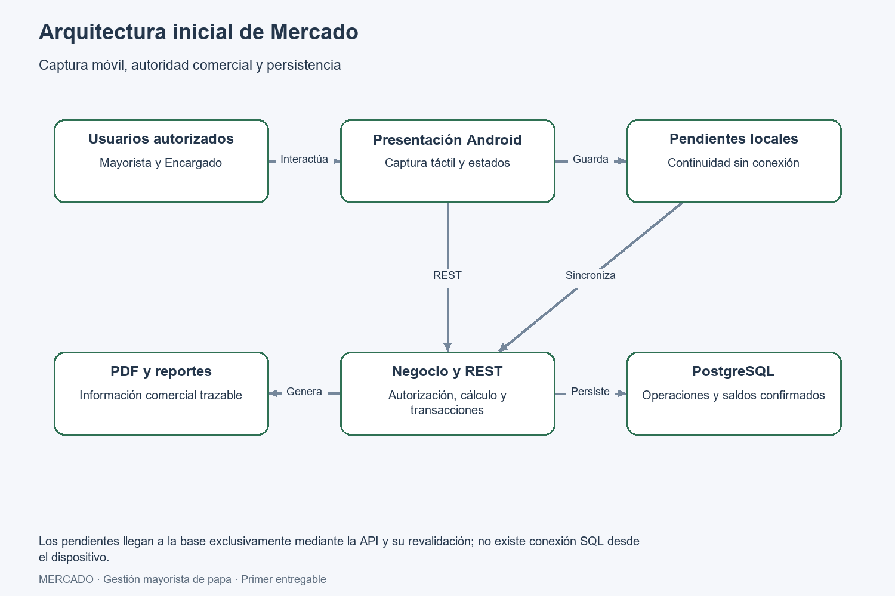

# Arquitectura inicial

> **Proyecto:** Gestión comercial mayorista de papa · **Entregable:** 1 · **Versión:** 2.0 · **Actualización:** 29 de octubre de 2026

## Visión de la solución

Mercado registra la recepción y el pesaje de cargamentos de papa, las compras, ventas y despachos, los costos de flete y estiba, y las cuentas por pagar y por cobrar, desde una tablet Android. La solución tiene tres piezas:

- **Aplicación Android** (Expo / React Native): captura, consulta y envío de documentos. Conserva las operaciones pendientes cuando no hay conexión.
- **API Mercado** (NestJS): monolito modular en capas que valida permisos y aplica las reglas de negocio.
- **PostgreSQL**: fuente oficial de operaciones, saldos, auditoría y documentos.

Las cantidades y pesos se guardan por operación, sin inventario. Sí se calculan importes y saldos de dinero.

## Diagrama

Fuente editable: [arquitectura-inicial.svg](../../img/fuentes-svg/arquitectura-inicial.svg).

| Grupo | Color | Responsabilidad |
| --- | --- | --- |
| Actores | Índigo | Mayorista y Encargado con reemplazo autorizado |
| Presentación y entrada API | Azul | Android captura y muestra resultados; la API REST valida identidad, permisos y datos |
| Lógica de negocio | Verde | Los ocho módulos de negocio |
| Datos | Ámbar | Pendientes cifrados en la tablet; hechos confirmados y documentos en PostgreSQL |
| Sistema externo | Violeta | WhatsApp o correo, elegidos por el Mayorista para enviar documentos |

Android y la API son aplicaciones distintas; aparecen juntas en la capa de presentación solo como agrupación conceptual.

## Módulos

El sistema se organiza en ocho módulos de negocio y tres responsabilidades transversales. La lista completa, con historias, requisitos y carpetas de código, está en [componentes arquitectónicos](componentes-arquitectonicos.md).

## Persistencia y continuidad

Android conserva la sesión y las operaciones pendientes cifradas por usuario y negocio. Una operación pendiente no está confirmada: al recuperar la conexión, el cliente la reenvía con el mismo UUID y la API revalida sesión, reemplazo, negocio y versión. Los reintentos devuelven el resultado original sin duplicar sacos ni efectos financieros; los conflictos se revisan sin sobrescritura. La tablet nunca accede a PostgreSQL directamente.

PostgreSQL conserva operaciones, pesajes, cuentas, costos, auditoría y el contenido de los PDF con su hash, versión y estado.

## Recorrido de recepción y compra

1. Registrar proveedor, fecha, vehículo, conductor y variedades esperadas.
2. Ingresar cada saco con variedad, calidad, procedencia, peso bruto y tara; revisar neto y totales.
3. Cerrar el pesaje.
4. Registrar precio, flete, adelantos, descuentos y forma de pago (contado o cuotas).
5. Confirmar la liquidación: en una sola transacción se guardan compra, cuenta o caja, flete pendiente y auditoría.
6. Generar el comprobante y, si el Mayorista lo decide, enviarlo al proveedor por WhatsApp.

## Integraciones externas

El envío por WhatsApp o correo es manual desde el dispositivo (ADR-03); el backend no envía mensajes. El MVP no incluye pasarela de pagos, ERP, courier, facturación electrónica, GPS ni balanzas integradas.

## Vistas relacionadas

- [Componentes arquitectónicos](componentes-arquitectonicos.md)
- [Enfoque arquitectónico](enfoque-arquitectonico.md)
- [Estilo arquitectónico](estilo-arquitectonico.md)
- [Modelo de datos](../03-diseño-de-software/modelo-de-datos.md)
- [C4 nivel 1](../04-modelo-c4/Nivel1-DiagramadeContextodelSistema.md) y [nivel 2](../04-modelo-c4/Nivel2-DiagramadeContenedores.md)
