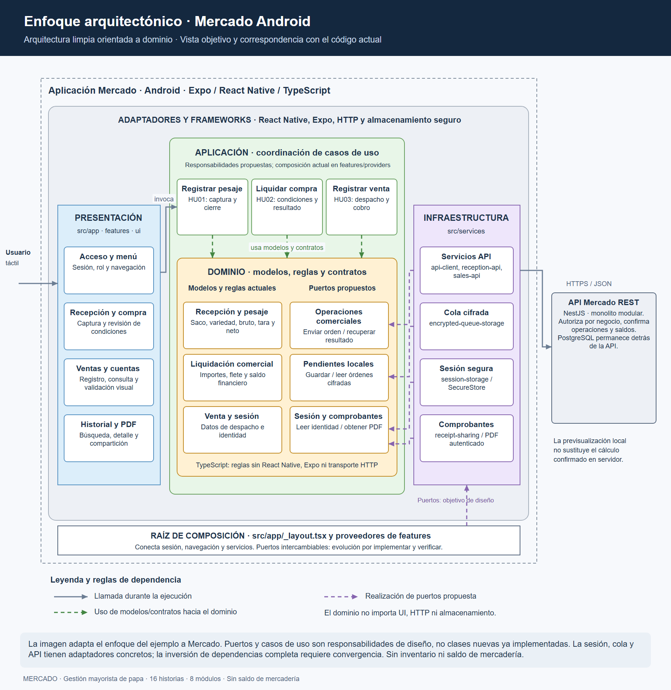

# Enfoque arquitectónico

> **Proyecto:** Gestión mayorista de papa · **Versión:** 1.3 · **Actualización:** 8 de octubre de 2026

## Enfoque seleccionado

Arquitectura limpia orientada a dominio, aplicada como objetivo de separación interna del cliente Android y compatible con el backend de monolito modular en capas. Se distinguen presentación, aplicación, dominio, infraestructura y raíz de composición. Las reglas comerciales deben permanecer independientes de la interfaz táctil, el transporte HTTP y el almacenamiento.

El enfoque define cómo organizar responsabilidades y dependencias; el estilo monolítico define cómo se despliega el backend. La aplicación usa Expo, React Native y TypeScript; la API NestJS confirma las operaciones en PostgreSQL. Las cantidades y pesos son registros por operación, sin inventario ni saldo de mercadería.

## Diagrama del enfoque

Fuente editable: [enfoque-arquitectonico.svg](../../img/fuentes-svg/enfoque-arquitectonico.svg).

## Capas y responsabilidades

| Capa | Aplicación al proyecto | Ubicación actual o condición |
| --- | --- | --- |
| Presentación | Acceso, menú, captura de pesos, compra, venta, consulta y mensajes | `src/app`, `src/features`, `src/ui` |
| Aplicación | Coordinar pesaje, liquidación, venta, abonos y recuperación de órdenes | Responsabilidades distribuidas en features/providers; casos de uso separados son objetivo de evolución |
| Dominio | Pesos, precisión monetaria, liquidación, datos de despacho, identidad y orden de sincronización | `src/domain`; las funciones puras no deben importar UI/transporte |
| Contratos o puertos | Definir capacidades de operaciones, pendientes, sesión y comprobantes | Interfaces propuestas para aislar consumidores; no se afirman puertos implementados para todos los servicios |
| Infraestructura | API HTTP, cola cifrada, sesión segura, obtención y compartición de PDF | `src/services/api`, `src/services/storage`, `src/services/receipts` |
| Composición | Conectar navegación, sesión y servicios concretos | `src/app/_layout.tsx` y proveedores de features; composición de puertos es evolución |

## Reglas de dependencia

1. El dominio conserva reglas y modelos independientes de React Native, Expo, HTTP y PostgreSQL.
2. La presentación invoca la coordinación de operaciones y muestra resultados; no determina saldos centrales.
3. Los casos de uso propuestos dependen de modelos y contratos. Los adaptadores concretos deben realizar dichos contratos al converger el diseño.
4. La raíz de composición elige y conecta las implementaciones; cambiar un adaptador debe preservar su contrato y sus errores.
5. Una orden offline conserva UUID, usuario, negocio y dependencias. El servidor revalida permisos y versión antes de confirmarla.
6. La tablet nunca abre conexiones SQL ni calcula mercadería restante. Las previsualizaciones de peso/dinero ayudan a revisar la captura; la respuesta central es la autoridad final.

## Correspondencia con código existente

| Ejemplo constatado | Función | Límite de la afirmación |
| --- | --- | --- |
| `src/domain/reception/purchase-preview.ts` | Previsualización de importes y validación de cuotas | No reemplaza liquidación central |
| `src/domain/auth/session.ts` | Identidad, roles y expiración | Permisos comerciales se revalidan en la API |
| `src/services/api/api-client.ts` | Transporte y respuestas HTTP | Adaptador concreto; no prueba puertos en todos los casos de uso |
| `src/services/storage/encrypted-queue-storage.ts` | Persistencia de pendientes cifrados | Requiere recuperación aislada por usuario/negocio |
| `src/features/auth/session/session-provider.tsx` | Coordinación de sesión en la aplicación | React participa en la coordinación actual; no se afirma separación completa de aplicación |

No se declara implementación completa de Clean Architecture. En el backend hay servicios con dependencia al ORM y entidades de varios dominios; su extracción debe conservar transacciones e idempotencia. En el cliente la coordinación todavía se distribuye entre features y proveedores. La vista de puertos expresa la dirección de mejora, no nombres de archivos ya existentes.

## Relación con las historias de usuario

HU01–HU03 corresponden a captura y confirmación comercial; HU04/HU08 a consulta y registro financiero; HU05 a continuidad offline; HU06 a analítica condicionada a criterios aprobados; HU07/HU12 a sesión y reemplazos; HU09 a estiba; HU10 a comprobantes; HU11/HU13 a historial y auditoría; HU14 a avisos de vencimiento. El canal externo de avisos sigue por definir y no se incorpora un proveedor al diagrama.

## Beneficios y verificación

La separación facilita probar peso y dinero con entradas reproducibles, cambiar presentación sin alterar resultados comerciales y sustituir infraestructura preservando contratos. Se verifica mediante revisión de imports, pruebas de dominio, contratos HTTP, autorización, reintentos idempotentes y recorridos Android. Una sustitución en memoria no acredita por sí sola la concurrencia real de PostgreSQL.

SDD organiza la evolución: constitution → specify → clarify → plan → tasks → implement → converge. Cada extracción o adaptador nuevo debe tener propósito, contrato y pruebas antes de implementarse. Figma es la referencia visual y no modifica reglas ni permisos. Los criterios analíticos CL-08 están aprobados; implementación, datos suficientes y evaluación son condiciones de habilitación.
