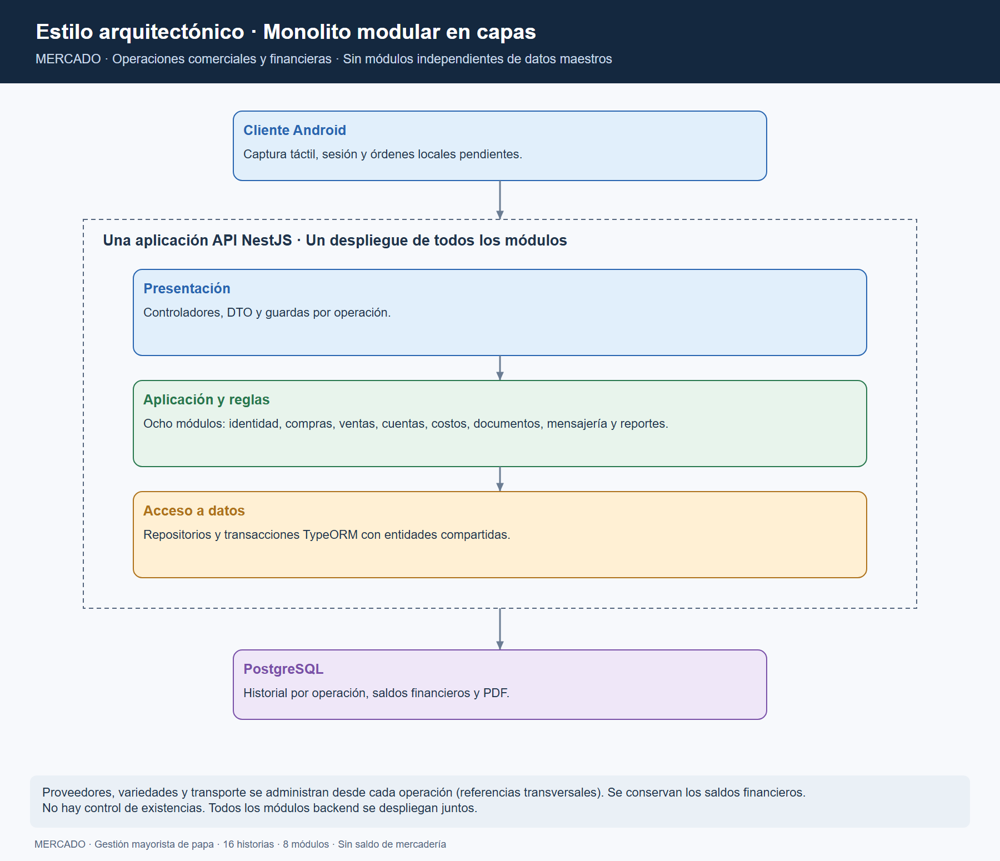

# Estilo arquitectónico

> **Proyecto:** Gestión comercial mayorista de papa · **Versión:** 2.0 · **Actualización:** 29 de octubre de 2026

## Estilo seleccionado

El backend es un **monolito modular organizado en capas**: la API y sus ocho módulos de negocio se ejecutan juntos en una aplicación NestJS con TypeScript, sobre PostgreSQL como base transaccional. El cliente Android es una aplicación separada que se comunica por REST versionada.

Este estilo permite confirmar en una sola transacción una venta, su cuenta por cobrar, su flete y su auditoría, sin coordinar servicios distribuidos, y se ajusta a la capacidad operativa del proyecto.

## Diagrama

Fuente editable: [estilo-arquitectonico.svg](../../img/fuentes-svg/estilo-arquitectonico.svg).

## Capas del backend

| Capa | Responsabilidad | Elementos |
| --- | --- | --- |
| Presentación | Recibir solicitudes, autenticar, autorizar, validar estructura y responder JSON | Controladores REST, DTO, guardas de sesión y rol, filtro uniforme de errores |
| Negocio | Coordinar operaciones, verificar invariantes y calcular resultados | Servicios de cada módulo; funciones de dominio en `common/domain` |
| Datos | Persistir y consultar hechos confirmados | Entidades y repositorios TypeORM, transacciones, restricciones y migraciones |

Sesión, aislamiento por negocio, auditoría, errores y trazas de solicitud son transversales.

## Módulos

Los ocho módulos de negocio y las responsabilidades transversales se describen en [componentes arquitectónicos](componentes-arquitectonicos.md).

## Reglas de interacción

1. Los controladores delegan en los servicios; no calculan importes.
2. Los servicios aplican reglas, autorización y transacciones.
3. Las operaciones que afectan dinero (compra, venta, abono, liquidación) se confirman de forma atómica con sus efectos en cuentas, caja, flete y auditoría.
4. Cada operación lleva un UUID: un reintento devuelve el resultado original y un UUID reutilizado con otros datos se rechaza.
5. Las correcciones y anulaciones registran motivo y compensación; no borran hechos confirmados.
6. Solo el servidor se conecta a PostgreSQL.
7. Para atender más carga se ejecutan varias instancias completas de la API, sin separar módulos en servicios.

## Justificación y consecuencias

| Aspecto | Beneficio | Costo |
| --- | --- | --- |
| Despliegue conjunto | Operación simple y uniforme | Cualquier cambio publica el backend completo |
| Base transaccional única | Consistencia entre operación y saldo | Mantener transacciones, restricciones y pruebas concurrentes |
| Organización modular | Responsabilidades reconocibles y evolución gradual | Vigilar el acoplamiento entre servicios y entidades |
| Cliente separado | Captura táctil y continuidad sin conexión | Gestionar reintentos, permisos vencidos y conflictos |

DA02, DA06, AC03, AC07 y R07 sustentan el estilo. Los microservicios solo se evaluarían ante una necesidad demostrada de despliegue o escalado independiente.

## Límites actuales

Los servicios usan repositorios TypeORM y acceden a entidades de módulos relacionados dentro de la misma transacción. Separar cada módulo detrás de una interfaz pública requiere pruebas de atomicidad y regresión, y es parte de la evolución descrita en el [enfoque arquitectónico](enfoque-arquitectonico.md).
