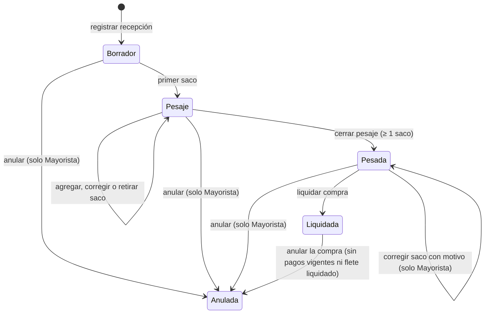
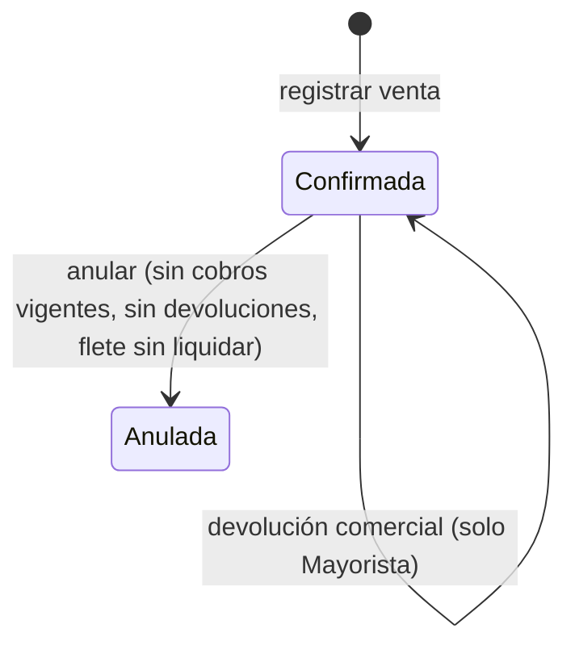
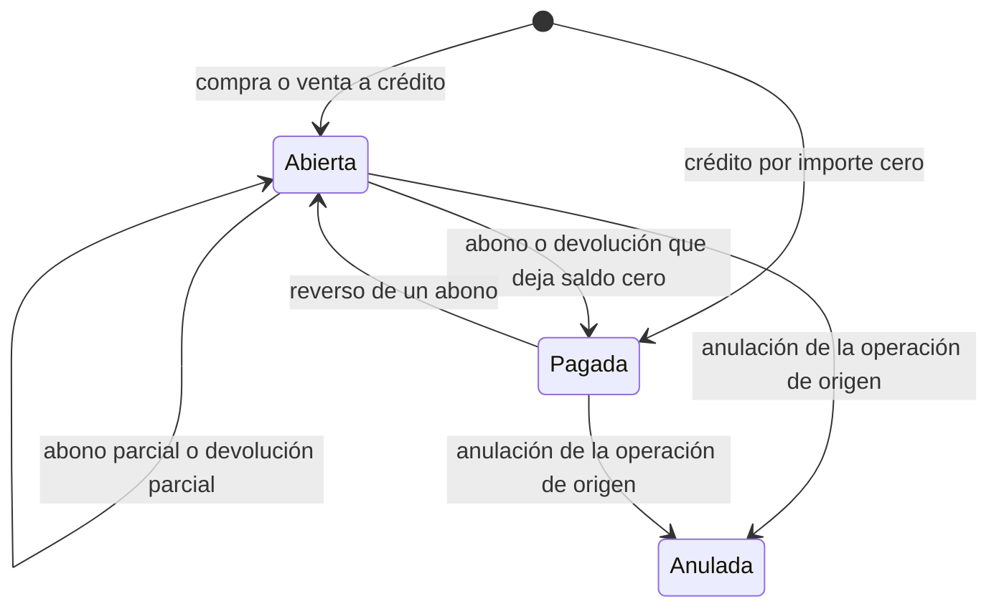
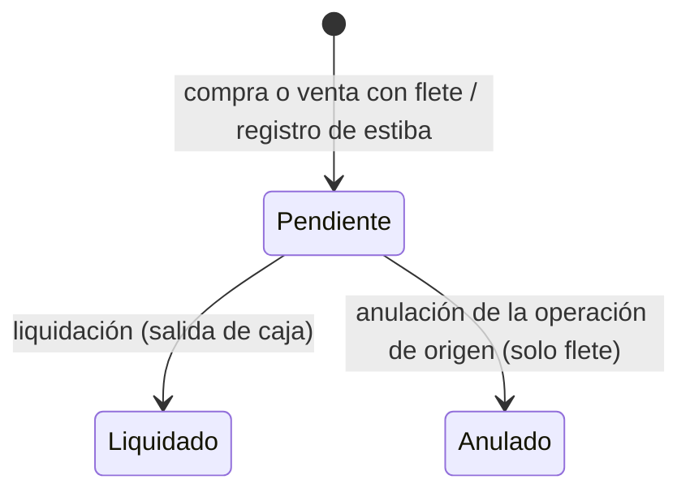
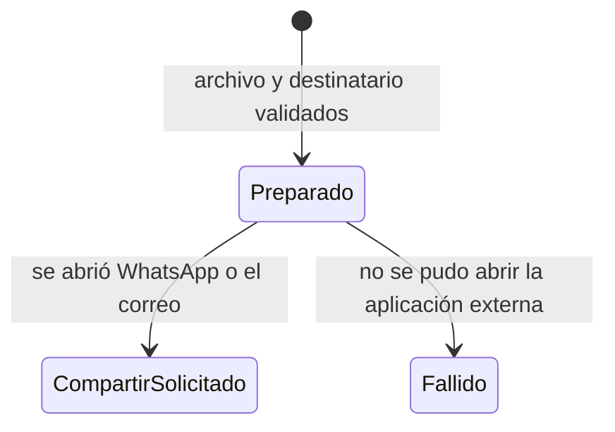

# Diagramas de estados

> **Proyecto:** Gestión comercial mayorista de papa · **Versión:** 2.0 · **Actualización:** 29 de octubre de 2026 · **Fuente:** enumeraciones y servicios de `mercado-api`

Cada cambio de estado incrementa la `version` del registro y queda en auditoría. Ningún estado final borra datos: las anulaciones conservan la operación con su motivo.

## Recepción (Recepción y compras)

| Estado | Código | Qué se puede hacer |
| --- | --- | --- |
| Borrador | `draft` | Agregar el primer saco o anular |
| Pesaje | `weighing` | Agregar, corregir o retirar sacos; cerrar el pesaje |
| Pesada | `weighed` | Liquidar la compra; el Mayorista puede corregir un saco con motivo |
| Liquidada | `settled` | Consultar; anular solo a través de la anulación de la compra |
| Anulada | `voided` | Solo consulta |

## Venta (Ventas y despachos)

Una devolución no cambia el estado de la venta: crea un registro de devolución, incrementa la versión de la venta y compensa la cuenta por cobrar o devuelve dinero de caja.

## Cuenta por pagar o por cobrar (Cuentas y caja)

| Estado | Código | Saldo |
| --- | --- | --- |
| Abierta | `open` | Mayor que cero; admite abonos |
| Pagada | `paid` | Cero; admite el reverso de un abono |
| Anulada | `voided` | Cero; no admite movimientos |

Las cuotas tienen dos estados, `open` y `paid`, según su saldo. Para anular la operación de origen, primero hay que revertir los abonos vigentes.

## Registro de flete y estiba (Costos logísticos)

## Intento de envío (Mensajería)

«Compartición solicitada» no significa entregado ni leído: el envío final lo confirma el Mayorista en la aplicación externa.
