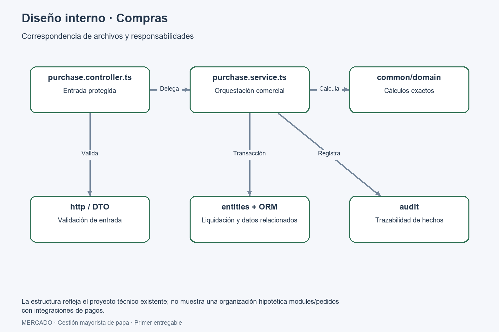

# Diseño interno de módulos

> **Proyecto:** Gestión comercial mayorista de papa · **Entregable:** 1 · **Versión:** 1.2

| Responsabilidad backend | Función | Historias y requisitos |
| --- | --- | --- |
| Identidad y reemplazos | Sesiones, permisos y reemplazos | HU07, HU12; RF01–02 |
| Recepción y pesaje | Proveedor, variedades, transporte, sacos, bruto/tara/neto y cierre | HU01; RF03–06B |
| Compras | Proveedor, precio, flete, adelantos, descuentos y liquidación | HU02; RF03, RF07, RF14 |
| Ventas y despachos | Comprador, variedades, destino, transporte y compensaciones | HU03; RF03–04, RF10–11, RF13 |
| Cuentas y caja | Pagos, cobros, cuotas, saldos y avisos de vencimiento | HU04, HU08, HU14; RF13–16, RF23 |
| Flete y estiba | Costos de transporte y liquidación de grupos | HU09; RF15 |
| Historial comercial | Búsqueda y detalle por fecha o participante | HU11; RF24 |
| Reportes y comprobantes | Consultas comerciales y generación/compartición PDF | HU10; RF12, RF17–18 |
| Auditoría | Usuario, fecha, acción, motivo y origen | HU13; RF22 |
| Analítica | Tendencias y estimaciones condicionadas a CL-08 | HU06; RF18–20 |

## Límites y datos

Toda consulta central recibe el negocio desde identidad autenticada. Las órdenes llevan UUID y, cuando corresponda, versión del agregado. Recepción conserva saco/variedad/bruto/tara/neto y estados; compras producen liquidación y cuenta o caja; ventas conservan las cantidades despachadas y generan cuenta o cobro. Las operaciones comerciales y financieras se confirman juntas. No se calcula mercadería restante ni se valida una venta contra compras previas.

Las anulaciones y devoluciones conservan el origen y generan compensaciones. No borrar hechos confirmados. Pagos superiores al saldo se rechazan; las cuotas y saldos se calculan en dominio y se revalidan en servidor. Peso usa tres decimales y dinero unidades menores, con redondeo mitad hacia arriba.

El cliente organiza `app`, `features`, `domain`, `data`, `services`, `ui`. La API tiene módulos `identity`, `reception`, `purchase`, `sales`, `accounts`, `freight`, `stowage`, `audit`, `reports` y persistencia con migraciones. El estado de pantalla no sustituye el resultado central.

Errores: sesión inválida bloquea acceso; permiso denegado conserva sesión válida; conflicto 409 pide revisión; falla de red mantiene pendiente. La recuperación no envía operaciones de otro usuario o negocio.

Para contratos y aceptación completos consultar los planes 001–006 en fuentes (documentación compartida del proyecto).

## Módulo de referencia: liquidación de compra

Se selecciona Compras porque relaciona pesaje, flete y obligaciones. Es la operación donde una diferencia de cálculo o un reintento duplicado puede alterar la liquidación y los saldos financieros.

### Estructura constatada en el proyecto técnico

```text
mercado-api/src/
├── purchase/
│   ├── purchase.module.ts
│   ├── purchase.controller.ts
│   ├── purchase.service.ts
│   ├── purchase.service.spec.ts
│   ├── http/settle-purchase.dto.ts
│   └── entities/purchase-settlement.entity.ts
├── common/domain/
│   ├── commercial-calculation.ts
│   ├── fixed-decimal.ts
│   └── proportional-allocation.ts
├── reception/
├── accounts/
├── freight/
└── audit/
```

| Archivo o grupo | Responsabilidad | Dependencia actual |
| --- | --- | --- |
| Controller | Recibir contrato, sesión e identificador y delegar | Servicio de compra, DTO y guardas |
| DTO | Representar y validar la entrada | Validación de frontera |
| PurchaseService | Idempotencia, reglas y transacción comercial | DataSource, AuditService y entidades relacionadas |
| common/domain | Cálculo decimal, importes y reparto | Lógica determinista reutilizable |
| Entidades/migraciones | Estructura y restricciones persistentes | ORM y PostgreSQL |
| Module | Composición e inyección | Dependencias concretas registradas |

### Reglas de dependencia y su estado

| Regla | Estado y verificación |
| --- | --- |
| Pantallas delegan operaciones a servicios y dominio | Revisar imports y reglas de lint del cliente |
| Cálculos no dependen de UI | Revisar funciones de common/domain y pruebas |
| Controladores no calculan líquido ni saldo | Revisar Controller → Service |
| Orquestación conserva atomicidad | Compras usa transacción y varias entidades |
| Aplicación totalmente independiente del ORM | Objetivo de evolución; no cumplido por PurchaseService actual |

### Reglas comerciales verificables

| Regla | Comportamiento esperado |
| --- | --- |
| Precisión | Peso con tres decimales y dinero en unidades menores; redondeo aprobado |
| Flete | Base por kg o por saco según acuerdo |
| Liquidación | Importe bruto menos flete, adelantos y descuentos |
| Pago | Contado o cuotas con saldo y vencimiento trazables |
| Reintento | UUID repetido devuelve resultado previo sin nuevos efectos |
| Concurrencia | Versión desactualizada produce conflicto y revisión |
| Corrección | Compensación con motivo y origen; no borrar hechos |

### Ejemplo de cálculo

Compra ilustrativa por kg: 100 kg netos × S/2,00 = S/200,00 bruto. Flete de S/0,10/kg = S/10,00; adelanto S/20,00 y descuento S/5,00. Líquido al proveedor: S/165,00. Este ejemplo verifica RF07; no define una tarifa fija ni sustituye el acuerdo comercial.

### Flujo y código de referencia

La secuencia y clases concretas están en [C4 nivel 4](../../04-modelo-c4/Nivel4-DiagramadeCodigo.md). Esquema ilustrativo independiente del framework:

```text
validar identidad, negocio, permiso y entrada
iniciar transacción
  bloquear clave negocio + UUID
  si existe resultado de la orden: devolver resultado previo
  validar versión y estado de recepción
  calcular bruto, flete, descuentos y líquido con precisión aprobada
  guardar liquidación y efectos de operaciones/cuentas/caja/flete
  registrar auditoría
confirmar transacción y devolver resultado central
```

El esquema explica responsabilidades; no reemplaza el código ejecutable ni supone puertos nuevos. Las pruebas deben cubrir rollback, autorización, precisión, cuotas, reintento y concurrencia.

## Imágenes del proyecto




Los diagramas representan las responsabilidades descritas en este documento. Cada imagen dispone de una fuente SVG editable en `img/fuentes-svg`, incluida la secuencia. Las fuentes SVG permiten editar los diagramas.

La secuencia muestra dos alternativas: recuperar una liquidación ya confirmada para el UUID, o validar y persistir una orden nueva. La primera omite el cálculo y las nuevas escrituras.

## Estado de convergencia técnica

Esta vista representa el alcance decidido el 7 de octubre de 2026. La implementación requiere verificaciones de convergencia contra el alcance vigente; no se incluye un módulo de existencias o valoración por lote en esta arquitectura. Las clases y rutas existentes son referencias técnicas, no evidencia de que esa adaptación ya esté implementada. Los reportes no calcularán un margen por existencias o valoración de lotes; mostrarán importes y costos comerciales registrados.

## Flujos complementarios y límites

HU07 valida credenciales y restaura o revoca sesión. HU12 autoriza/revoca un reemplazo de máximo 24 horas, con revalidación central al operar. HU08 registra un pago/cobro idempotente y actualiza la cuenta/caja; no confundir con la consulta HU04. HU09 liquida trabajo de estiba por grupo. HU10 comparte un PDF interno confirmado; no incluye facturación electrónica. HU11 filtra historial de operaciones; HU13 consulta acciones auditadas con usuario y motivo. HU14 presenta vencimientos y conserva como pendiente cualquier canal externo sin definir.

Validaciones: dinero positivo y no superior al saldo; vencimientos asociados a la cuenta; filtros y archivos aislados por negocio; auditoría de correcciones inmutable; solo el Mayorista accede a las historias complementarias HU08–HU14. Definir canal, frecuencia y política de recordatorios antes de añadir una integración externa.

## Organización vigente de los datos comerciales

Proveedores, compradores, variedades, vehículos y transportistas son datos de recepción, compras y ventas. No constituyen módulos independientes. Recepción conserva proveedor, variedad, vehículo y conductor del cargamento; compras utiliza esos datos para la liquidación; ventas conserva comprador, destino y transporte del despacho. RF03–RF05 mantienen su trazabilidad dentro de esas operaciones. Esta organización es el diseño vigente; no afirma una reorganización ya implementada del código.

## Responsabilidad del cliente y agrupaciones

Los nombres son responsabilidades del backend, no servicios desplegados por separado. **Cola y sincronización** pertenece al cliente Android (HU05; RF21): conserva órdenes cifradas y las reenvía a los contratos centrales. Los avisos financieros pertenecen a Cuentas y caja; Analítica analiza el historial. Las devoluciones y anulaciones son operaciones compensatorias dentro de Ventas y despachos o Compras, no módulos nuevos.

## Ejemplos de saldos y excepciones

| Operación ilustrativa | Importe inicial | Abono | Saldo financiero |
| --- | --- | --- | --- |
| Compra a crédito del proveedor | S/1.000,00 | S/600,00 pagados | S/400,00 por pagar |
| Venta a crédito al comprador | S/800,00 | S/300,00 cobrados | S/500,00 por cobrar |

En la compra el importe inicial representa la obligación final después de los descuentos acordados. Cada abono conserva fecha, responsable, origen y UUID. Reenviar el abono no modifica el saldo por segunda vez. Un abono mayor al saldo se rechaza sin escrituras parciales. El comprobante y la consulta de cuenta deben mostrar los mismos importes confirmados.

Los sacos y pesos permanecen en el detalle de cada operación. Una compra de 100 sacos y una venta de 30 no producen un saldo de 70 sacos disponibles.

Una anulación después de abonos no borra compra, venta ni pagos: conserva el origen y registra las compensaciones autorizadas. La comprobación debe contrastar cuenta, caja, abonos y auditoría antes/después. Anular una operación no demuestra por sí solo una devolución real de dinero; no se inventa un reembolso automático. La política del caso concreto debe estar especificada antes de implementarlo.

Si el reemplazo vence antes de sincronizar, la API rechaza la confirmación y no aplica efectos. La interfaz conserva la orden como pendiente de revisión y muestra el motivo; no elimina el registro ni promete confirmación automática. El tratamiento posterior requiere una acción autorizada conforme a la especificación.
