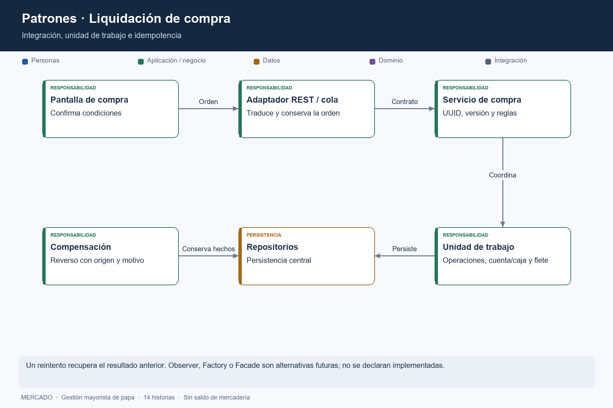

# Patrones de diseño aplicados

> **Proyecto:** Gestión comercial mayorista de papa · **Entregable:** 1 · **Versión:** 2.0 · **Actualización:** 29 de octubre de 2026

| Patrón o mecanismo | Aplicación en el proyecto | Límite |
| --- | --- | --- |
| Inyección de dependencias | Los servicios NestJS reciben `DataSource`, `AuditService` y repositorios | No implica arquitectura hexagonal completa |
| DTO y validación en la frontera | `purchase/http/settle-purchase.dto.ts` y los DTO de cada controlador | El servicio revalida las invariantes de negocio |
| Repositorio | Acceso a datos mediante repositorios TypeORM | Algunos servicios usan repositorios de otros módulos |
| Unidad de trabajo | `DataSource.transaction` agrupa operación, cuenta o caja, flete y auditoría | Todas las escrituras críticas comparten transacción |
| Operación idempotente | `clientOperationId` + bloqueo por negocio y UUID; se compara el reintento con lo guardado (`requireSameOperation`) | El UUID no sustituye autorización ni versión |
| Concurrencia optimista | Campo `version` en recepciones, ventas, compras y cuentas; `409` si no coincide | Los conflictos se resuelven con revisión, no sobrescribiendo |
| Bloqueo pesimista | `SELECT … FOR UPDATE` sobre la recepción, la venta o la cuenta afectada | Mantener un orden de bloqueo consistente |
| Cola persistente en el cliente | Pendientes cifrados y reintento ordenado | No hay broker ni outbox en el servidor |
| Adaptador | Servicios de API, sesión, selector de archivos y compartición en Android | La pantalla no conoce el transporte |
| Compensación | Anulaciones, reversos de pago y devoluciones referencian el hecho original | No es Event Sourcing ni saga distribuida |

La selección responde a AC03 (integridad), AC04 (seguridad) y AC07 (mantenibilidad).

## Aplicación a la liquidación de compra

| Patrón | Operación concreta | Beneficio |
| --- | --- | --- |
| Adaptador | El servicio móvil traduce la orden a la petición REST y la respuesta a un modelo de pantalla | La pantalla no maneja detalles HTTP |
| Repositorio | El servicio busca la recepción y persiste la liquidación | Acceso a datos agrupado |
| Unidad de trabajo | Liquidación, cuenta o caja, flete y auditoría en una transacción | Sin operaciones a medias |
| Idempotencia | Un reenvío tras perder la respuesta devuelve la misma compra | Sin compras ni deudas duplicadas |
| Compensación | La anulación registra el reverso vinculado | Historial completo |

Fuente editable: [patrones-compra.svg](../../../img/fuentes-svg/patrones-compra.svg).

## Patrones para la evolución

- **Fachada por módulo:** reduciría el acceso directo de Compras y Ventas a entidades de Cuentas y caja.
- **Observer:** podría notificar a Mensajería cuando una cuenta se acerque a su vencimiento, si en el futuro se automatizan los recordatorios.
- **Factory:** solo si la construcción de operaciones adquiere variantes complejas.

No se incorpora una caché (por ejemplo, Redis): no hay una necesidad medida y los saldos oficiales no deben depender de ella.
