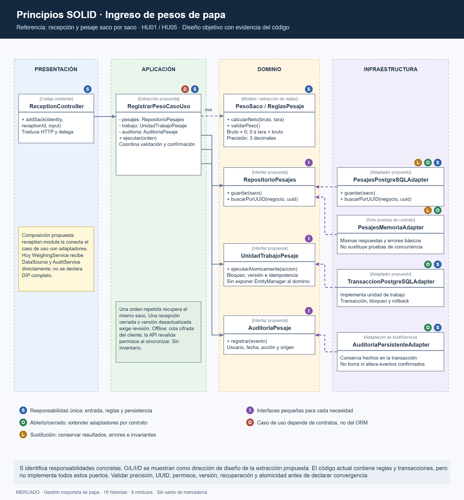

# Principios de diseño

> **Proyecto:** Gestión mayorista de papa · **Módulo de referencia:** Recepción e ingreso de pesos · **Versión:** 1.3

## Objetivo

Aplicar SOLID al registro del peso de cada saco de papa, separando captura, reglas de bruto/tara/neto, coordinación, persistencia y auditoría. La captura pertenece a HU01 y la continuidad sin conexión a HU05. Los pesos son datos de cada cargamento: no producen inventario ni saldo de mercadería.

## SOLID en el ingreso de pesos

Fuente editable: [solid-modulo-pesaje.svg](../../../img/fuentes-svg/solid-modulo-pesaje.svg).

El diagrama combina un controlador constatado con una propuesta de extracción de casos de uso, reglas y contratos. Los nombres de puertos y adaptadores expresan el diseño objetivo; no son clases completas que ya existan en el repositorio técnico.

| Principio | Aplicación al ingreso de pesos | Elementos y estado |
| --- | --- | --- |
| S · Responsabilidad única | El controlador traduce entrada; las reglas calculan neto; el caso de uso coordina; persistencia y auditoría conservan hechos | `ReceptionController`, reglas `calculateWeights` y `WeighingService` existen. La extracción de `RegistrarPesoCasoUso` y `PesoSaco` es propuesta |
| O · Abierto/cerrado | Agregar otra implementación del contrato sin modificar reglas de peso | Adaptadores propuestos de PostgreSQL y memoria. No habilita una balanza integrada, fuera del MVP |
| L · Sustitución de Liskov | Implementaciones intercambiables preservan precisión, UUID, aislamiento y respuestas/errores del contrato | Memoria solo apoya pruebas de contrato; no acredita bloqueos, concurrencia, seguridad o durabilidad de PostgreSQL |
| I · Segregación de interfaces | El registro usa capacidades pequeñas de pesajes, unidad de trabajo y auditoría | Puertos propuestos `RepositorioPesajes`, `UnidadTrabajoPesaje`, `AuditoriaPesaje`; no requieren caja, reportes ni inventario |
| D · Inversión de dependencias | El caso de uso propuesto recibe contratos, y la composición conecta adaptadores | Objetivo de evolución. `WeighingService` actualmente recibe `DataSource` y `AuditService`; inyección no implica DIP completo |

## Recorrido del registro

1. Mayorista o Encargado con reemplazo vigente selecciona la variedad e ingresa el peso bruto y la tara cuando corresponde.
2. La aplicación valida la captura y conserva la orden pendiente si falla la conexión; ese estado no equivale a confirmación central.
3. El controlador central valida identidad, permisos, negocio y estructura de entrada; delega la operación de pesaje.
4. La unidad de trabajo central recupera un resultado existente por UUID o valida recepción, estado, variedad y versión antes de registrar un saco nuevo.
5. Las reglas calculan neto = bruto − tara con tres decimales. El detalle, secuencia, responsable y auditoría se confirman juntos.
6. El cliente muestra el resultado confirmado. Un conflicto requiere revisión; una repetición no agrega otro saco.

## Reglas del dominio

| Regla | Comportamiento esperado |
| --- | --- |
| Peso bruto | Mayor que cero; entrada decimal válida con hasta tres decimales |
| Tara | Mayor o igual a cero y menor que el bruto; si se omite se considera cero |
| Peso neto | Diferencia positiva calculada de forma determinista |
| Variedad | Debe pertenecer a la recepción que se está pesando |
| Estado de recepción | Nuevos sacos solo mientras la recepción permita captura; un cierre no se sobrescribe |
| Versión y UUID | Detectar concurrencia y conservar un único resultado de la orden |
| Corrección | Autorización y trazabilidad según estado; no borrar hechos confirmados |
| Totales | Cantidad de sacos y peso por variedad/cargamento; nunca saldo de almacén |

Ejemplo: bruto **52,500 kg** y tara **0,500 kg** producen **52,000 kg netos**. Una tara de **52,500 kg** con el mismo bruto se rechaza porque el neto sería cero.

## Evidencia en el código actual

| Archivo del proyecto técnico | Responsabilidad constatada |
| --- | --- |
| `mercado-api/src/reception/reception.controller.ts` | Entrada `addSack` y delegación de la operación |
| `mercado-api/src/reception/http/weighing.dto.ts` | UUID, versión, variedad, peso bruto y tara; validación de formato |
| `mercado-api/src/reception/weighing.service.ts` | `add`, transacción, bloqueo por negocio/UUID, estado, variedad, versión y `calculateWeights` |
| `mercado-api/src/common/domain/fixed-decimal.ts` | Conversión decimal determinista usada por las reglas |
| `mercado-app/src/domain/reception/reception.ts` | Modelo del saco y representación de resultados para la interfaz |
| `mercado-app/src/services/api/reception-api.ts` | Envío de `addSack` al contrato central |

Las reglas `calculateWeights` permanecen dentro del servicio actual. Separarlas sin cambiar comportamiento es una mejora propuesta, que debe conservar transacción e idempotencia. No copiar un repositorio en memoria en producción ni sustituir el bloqueo central por validación de pantalla.

## Verificación de principios y contratos

- Probar bruto positivo, tara cero/omitida, tara igual o mayor que bruto, formato inválido y precisión de tres decimales.
- Reenviar la misma orden cinco veces y comprobar un único saco y una sola auditoría de creación.
- Rechazar variedad ajena, recepción cerrada, versión antigua o reemplazo revocado sin escrituras parciales.
- Comprobar rollback si falla auditoría/persistencia; mantener detalle y evento en una unidad de trabajo.
- Ejecutar pruebas de contrato al sustituir adaptadores y pruebas PostgreSQL para concurrencia e integridad real.
- Validar recuperación offline y captura táctil; mostrar pendiente, confirmado, error y revisión sin perder pesos.

## Principios transversales

Conservar separación por usuario/negocio, registros trazables, estados accesibles y componentes visuales consistentes con Figma. No introducir interfaces o patrones solo para decorar el diagrama: cada extracción requiere una necesidad, contrato y pruebas mediante SDD antes de implementarse. El backend sigue siendo un monolito modular en capas.
