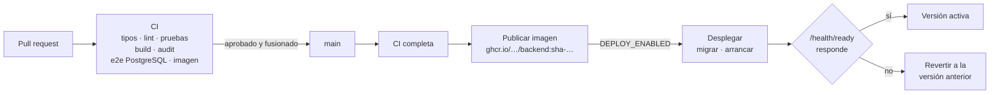

# Entrega y despliegue continuos

> **Proyecto:** Gestión comercial mayorista de papa · **Versión:** 2.1 · **Actualización:** 29 de octubre de 2026 · **Fuente:** `.github/workflows/` y `backend/deploy/`

## Principio

- **Integración continua (CI):** cada cambio propuesto se verifica automáticamente antes de integrarse en `main`.
- **Entrega continua:** cada commit en `main` que supera la verificación produce un artefacto versionado y listo para producción (una imagen Docker), sin pasos manuales.
- **Despliegue continuo:** ese artefacto se instala automáticamente en producción, se migra la base, se comprueba la salud y, si falla, se vuelve a la versión anterior.

`main` es la única rama de entrega: todo cambio llega mediante un pull request que pasa la CI (ADR-05).

## Flujo

## Pipelines

| Workflow | Se ejecuta | Trabajos |
| --- | --- | --- |
| `backend-ci.yml` | En cada PR que toca `backend/` | **Verificar:** `npm ci`, `typecheck`, `lint`, pruebas unitarias, `build` y `npm audit` sin vulnerabilidades altas. **PostgreSQL:** migraciones y pruebas e2e contra un PostgreSQL 17 efímero. **Imagen:** construcción de la imagen Docker. |
| `backend-cd.yml` | En cada push a `main` que toca `backend/`, o manualmente | **CI** completa (reutiliza `backend-ci.yml`) → **Publicar** la imagen con etiquetas `sha-<commit>` y `latest` → **Desplegar** en producción si el entorno está habilitado. |
| `docs-ci.yml` | En cada PR o push que toca Markdown o imágenes | Verifica que no haya enlaces ni anclas rotos. |

## Despliegue en el servidor

`backend/deploy/deploy.sh` se ejecuta en el servidor por SSH con la etiqueta de la imagen recién publicada:

1. Descarga la imagen `API_IMAGE:sha-…`.
2. Aplica las migraciones pendientes con un contenedor de un solo uso.
3. Reemplaza el contenedor `api`.
4. Consulta `/api/v1/health/ready` durante un minuto.
5. Si responde, guarda la etiqueta como versión activa; si no, arranca de nuevo la versión anterior y el pipeline falla.

`backend/deploy/compose.prod.yaml` define PostgreSQL, el servicio de migraciones y la API, que solo escucha en `127.0.0.1` para quedar detrás de un proxy inverso con HTTPS. La documentación OpenAPI está desactivada por defecto en producción.

### Regla para las migraciones

Como la reversión solo cambia el contenedor de la API, cada migración debe ser compatible con la versión anterior: primero se **expande** (agregar columnas o tablas) y, en un despliegue posterior, se **contrae** (eliminar lo que ya no se usa). Nunca se borran datos en la misma versión que deja de usarlos.

## Configuración en GitHub

El despliegue automático se activa cuando existe el entorno **production** con estos valores. Mientras no exista, la entrega continua sigue funcionando: cada commit en `main` publica su imagen.

| Tipo | Nombre | Contenido |
| --- | --- | --- |
| Variable | `DEPLOY_ENABLED` | `true` para activar el despliegue |
| Variable | `DEPLOY_HOST` | Servidor de producción |
| Variable | `DEPLOY_USER` | Usuario SSH con permiso para usar Docker |
| Variable | `DEPLOY_PATH` | Carpeta del despliegue, con su `.env` |
| Variable | `API_PUBLIC_URL` | URL pública de la API |
| Secreto | `DEPLOY_SSH_KEY` | Clave privada SSH exclusiva para despliegues |
| Secreto | `DEPLOY_KNOWN_HOSTS` | Huella del servidor (`ssh-keyscan`) |

El servidor necesita Docker con Compose y un archivo `.env` en `DEPLOY_PATH` con las variables de `backend/.env.example` (contraseña de base de datos, `CORS_ORIGINS`, etc.). Las credenciales nunca se guardan en el repositorio.

Se recomienda proteger `main` en GitHub para exigir un PR con la CI aprobada antes de fusionar.

## Relación con los atributos de calidad

| Atributo | Cómo lo apoya el pipeline |
| --- | --- |
| AC03 Integridad | Las pruebas de idempotencia y las e2e se ejecutan en cada cambio |
| AC04 Seguridad | `npm audit` bloquea vulnerabilidades altas; los secretos viven en GitHub, no en el código |
| AC07 Mantenibilidad | Un cambio localizado se verifica y se despliega en minutos |
| AC08 Recuperación | Cada versión queda publicada y se puede volver a desplegar por su etiqueta |
