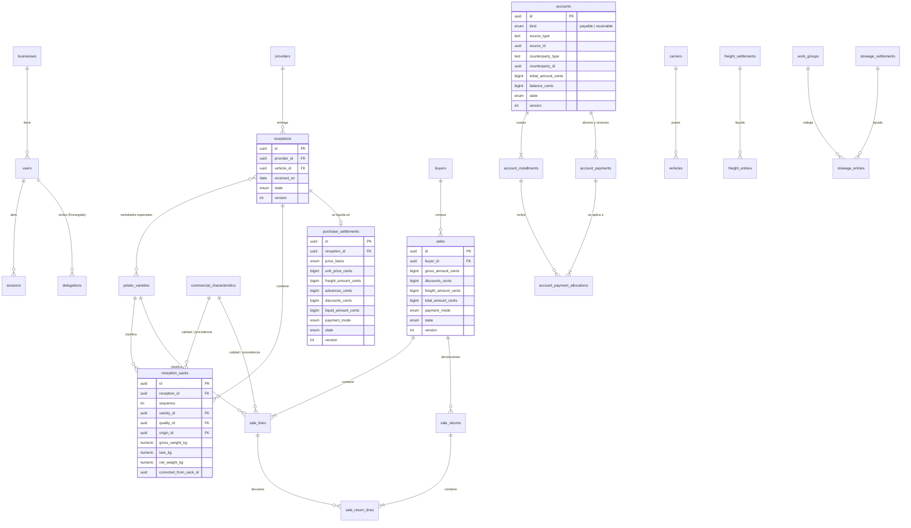

# Modelo de datos

> **Proyecto:** Gestión comercial mayorista de papa · **Versión:** 2.0 · **Actualización:** 29 de octubre de 2026 · **Fuente:** entidades y migraciones de `backend/`

PostgreSQL es la fuente oficial. Todas las tablas de negocio llevan `business_id` y cada consulta filtra por él. Los importes se guardan en céntimos (`bigint`) y los pesos en kilogramos con tres decimales (`numeric(…, 3)`). Las operaciones que llegan desde la tablet tienen `client_operation_id` único por negocio para la idempotencia.

## Diagrama entidad-relación

Se muestran las tablas y claves principales; se omiten columnas de auditoría (`created_at`, `created_by_user_id`) y textos.

## Tablas por módulo

| Módulo | Tablas |
| --- | --- |
| Identidad y acceso | `businesses`, `users`, `sessions`, `delegations` |
| Recepción y compras | `receptions`, `reception_expected_varieties`, `reception_sacks`, `purchase_settlements` |
| Ventas y despachos | `sales`, `sale_lines`, `sale_returns`, `sale_return_lines` |
| Cuentas y caja | `accounts`, `account_installments`, `account_payments`, `account_payment_allocations`, `cash_movements` |
| Costos logísticos | `freight_entries`, `freight_settlements`, `work_groups`, `stowage_entries`, `stowage_settlements` |
| Documentos | `receipt_documents` |
| Mensajería | `message_share_attempts` |
| Reportes y analítica | `analytics_evaluations`, `analytics_publications`, `analytics_outcomes` |
| Auditoría | `audit_events` |
| Referencias comerciales | `providers`, `buyers`, `potato_varieties`, `commercial_characteristics`, `carriers`, `vehicles` |
| Histórico sin uso | `inventory_lots`, `inventory_movements`, `inventory_lot_valuations`, `sale_line_costs` (conservadas tras ADR-01) |

## Relaciones polimórficas

Algunas tablas apuntan a operaciones de distinto tipo mediante un par tipo + identificador, sin clave foránea:

| Tabla | Columnas | Valores |
| --- | --- | --- |
| `accounts` | `source_type`, `source_id` | `purchase-settlement`, `sale` |
| `accounts` | `counterparty_type`, `counterparty_id` | `provider`, `buyer` |
| `cash_movements` | `source_type`, `source_id` | compra, venta, abono, devolución, flete, estiba |
| `freight_entries` | `operation_type`, `operation_id` | `purchase`, `sale` |
| `stowage_entries` | `operation_type`, `operation_id` | `purchase`, `sale` |
| `receipt_documents` | `source_type`, `source_id` | `purchase`, `sale`, `sale-return` (comprobantes PDF); `buyer-statement` (PDF) y `buyer-statement-image` (PNG) del estado de cuenta, con `source_id` del comprador |
| `audit_events` | `resource_type`, `resource_id` | cualquier recurso auditado |

La integridad de estas referencias la garantiza el servicio dentro de la transacción.

## Restricciones relevantes

- `(business_id, client_operation_id)` único en cada tabla de operaciones.
- `lower(username)` único en `users`.
- `token_hash` único en `sessions`; el token en claro nunca se guarda.
- Una cuenta por operación de origen: `(business_id, source_type, source_id)` único en `accounts`.
- `receipt_documents` admite `application/pdf` e `image/png` (migración 028) y conserva cada versión durante el periodo de retención; un trigger impide borrarlas antes.
- Las migraciones se aplican de forma explícita (`npm run migration:run`); `synchronize` está desactivado.
