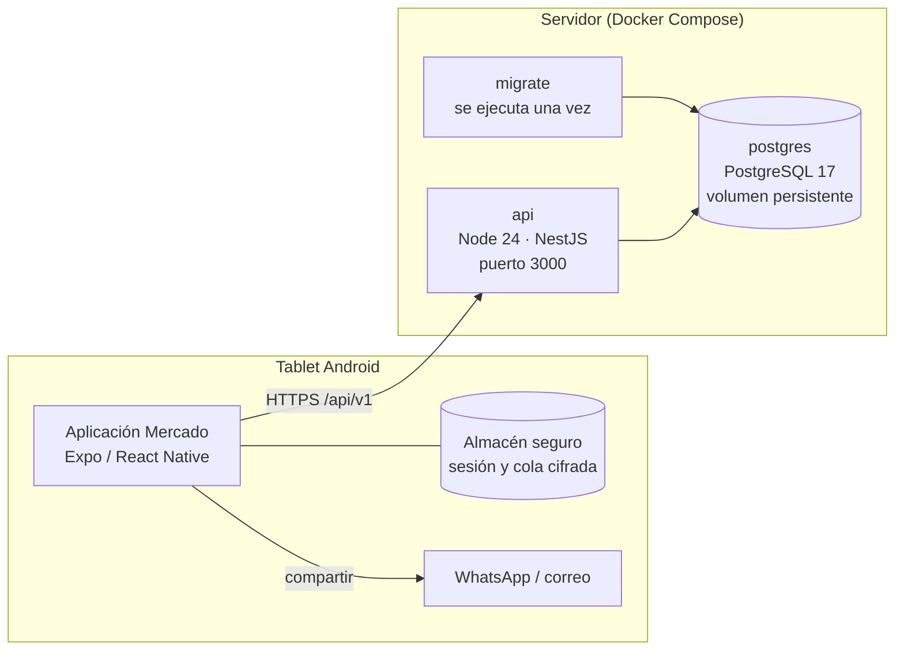

# Vista de despliegue

> **Proyecto:** Gestión comercial mayorista de papa · **Versión:** 2.0 · **Actualización:** 29 de octubre de 2026 · **Fuente:** `Dockerfile` y `compose.yaml` de `mercado-api`

## Nodos

| Nodo | Imagen o tecnología | Responsabilidad |
| --- | --- | --- |
| Tablet Android | Expo / React Native | Interfaz, sesión segura y cola cifrada de pendientes |
| `postgres` | `postgres:17-alpine` con volumen `mercado-postgres-data` | Base de datos central |
| `migrate` | Misma imagen que la API | Aplica las migraciones pendientes y termina; la API espera a que finalice bien |
| `api` | `node:24-alpine`, multi-etapa, usuario sin privilegios | API REST `/api/v1`; health checks en `/api/v1/health/live` y `/api/v1/health/ready` |

## Configuración

Variables principales (ver `.env.example`): conexión a PostgreSQL (`DATABASE_*`, contraseña de al menos 12 caracteres), `CORS_ORIGINS`, `SESSION_TTL_MINUTES`, `EVIDENCE_RETENTION_YEARS` (mínimo 5) y `OPENAPI_ENABLED`. La configuración se valida al arrancar; si falta un valor obligatorio, la API no inicia.

## Operación

| Tarea | Mecanismo |
| --- | --- |
| Crear el primer Mayorista | `npm run bootstrap:wholesaler` con variables `BOOTSTRAP_*`, una sola vez |
| Respaldo | `scripts/backup-postgres.ps1` (volcado de PostgreSQL con manifiesto) |
| Restauración | `scripts/restore-postgres.ps1` |
| Escalado | Varias instancias de `api` detrás de un balanceador; el estado vive en PostgreSQL |

## Pendiente para producción

- Terminación HTTPS (proxy inverso) y configuración de `trust proxy` para el límite de intentos de inicio de sesión.
- Desactivar la documentación OpenAPI (`OPENAPI_ENABLED=false`).
- Respaldos programados y simulacro de restauración con RPO/RTO medidos (AC08).
- Monitoreo de disponibilidad (AC02).
