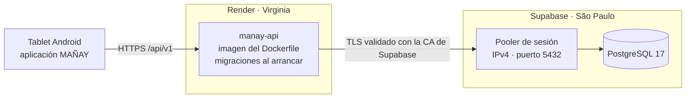
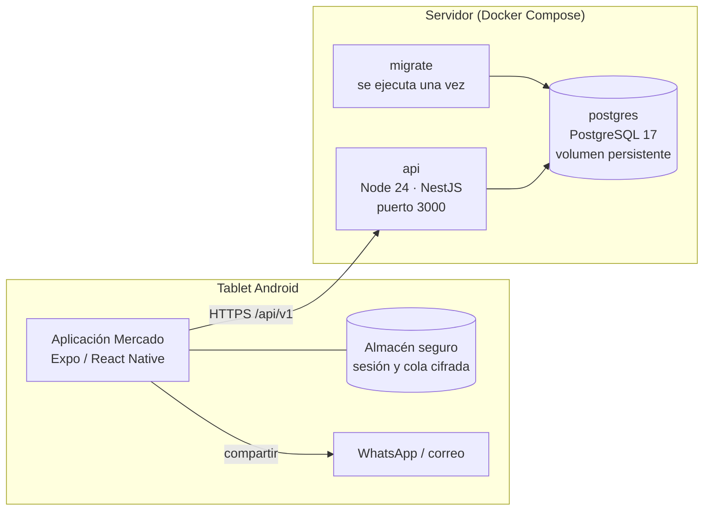

# Vista de despliegue

> **Proyecto:** Gestión comercial mayorista de papa · **Versión:** 3.0 · **Actualización:** 20 de noviembre de 2026 · **Fuente:** `Dockerfile` y `compose.yaml` de `backend/`, `render.yaml`

## Entorno en internet (spec 018)

Desde el 20 de noviembre de 2026 la API corre en Render y la base de datos en Supabase, ambos en plan gratuito. Los pasos están en la [guía de despliegue](guia-despliegue-supabase-render.md).

| Elemento | Configuración |
| --- | --- |
| API | `render.yaml`: servicio web Docker, chequeo de salud en `/api/v1/health/ready`, `TRUST_PROXY=1`, OpenAPI desactivado |
| Migraciones | `dockerCommand` aplica las pendientes antes de arrancar la API (el plan gratuito no tiene `preDeployCommand`) |
| Base de datos | Pooler de sesión; la conexión directa es solo IPv6 |
| TLS | `DATABASE_SSL=true`, validación activa y CA en `DATABASE_SSL_CA` |
| Secretos | `DATABASE_HOST`, `DATABASE_USER`, `DATABASE_PASSWORD` y `DATABASE_SSL_CA` solo en el panel de Render |

## Entorno local y servidor propio (Docker Compose)

## Nodos

| Nodo | Imagen o tecnología | Responsabilidad |
| --- | --- | --- |
| Tablet Android | Expo / React Native | Interfaz, sesión segura y cola cifrada de pendientes |
| `postgres` | `postgres:17-alpine` con volumen `mercado-postgres-data` | Base de datos central |
| `migrate` | Misma imagen que la API | Aplica las migraciones pendientes y termina; la API espera a que finalice bien |
| `api` | `node:24-alpine`, multi-etapa, usuario sin privilegios | API REST `/api/v1`; health checks en `/api/v1/health/live` y `/api/v1/health/ready` |

## Configuración

Variables principales (ver `.env.example`): conexión a PostgreSQL (`DATABASE_*`, contraseña de al menos 12 caracteres; `DATABASE_SSL_CA` para una CA propia del proveedor), `CORS_ORIGINS`, `SESSION_TTL_MINUTES`, `EVIDENCE_RETENTION_YEARS` (mínimo 5), `OPENAPI_ENABLED` (desactivado por defecto con `NODE_ENV=production`) y `TRUST_PROXY` (saltos o direcciones del proxy inverso, para que el límite de intentos de inicio de sesión vea la IP real de cada cliente). La configuración se valida al arrancar; si falta un valor obligatorio, la API no inicia.

## Operación

| Tarea | Mecanismo |
| --- | --- |
| Crear el primer Mayorista | `npm run bootstrap:wholesaler` con variables `BOOTSTRAP_*`, una sola vez |
| Respaldo | `scripts/backup-postgres.ps1` (volcado de PostgreSQL con manifiesto) |
| Restauración | `scripts/restore-postgres.ps1` |
| Escalado | Varias instancias de `api` detrás de un balanceador; el estado vive en PostgreSQL |

## Producción

En producción la API no se construye en el servidor: se usa la imagen que publica el pipeline de entrega continua, con `backend/deploy/compose.prod.yaml` (API solo en `127.0.0.1` y OpenAPI desactivado por defecto) y `backend/deploy/deploy.sh` (migrar, arrancar, comprobar salud y revertir). El proceso completo está en [entrega y despliegue continuos](entrega-y-despliegue-continuos.md).

## Pendiente para producción

- Plan de pago o servidor propio para evitar que el servicio duerma; el entorno gratuito de Render y Supabase es para pruebas y demostración.
- Respaldos programados y simulacro de restauración con RPO/RTO medidos (AC08).
- Monitoreo de disponibilidad (AC02).
