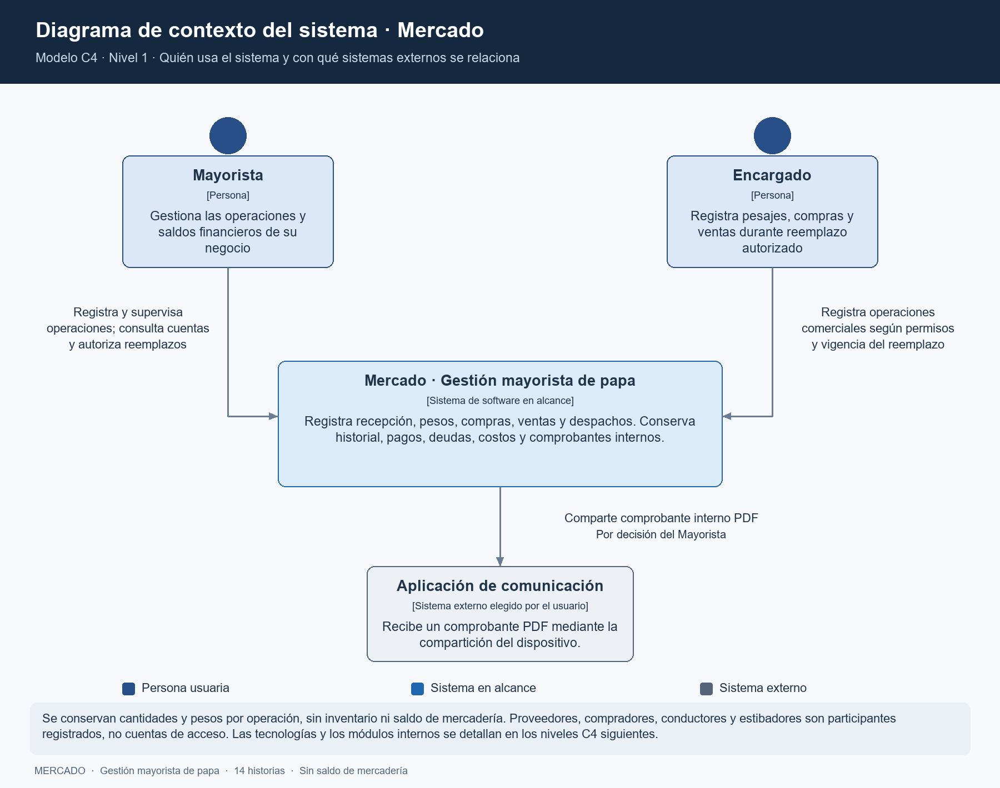

# Nivel 1 Diagrama de contexto del sistema

> **Proyecto:** Gestión mayorista de papa · **Modelo:** C4 · **Nivel:** 1 · **Versión:** 1.3

## Objetivo y alcance de la vista

Mostrar Mercado como un único sistema: quién lo utiliza, qué necesidad atiende y con qué sistema externo se relaciona. Esta vista está dirigida al mayorista, docente, diseño y equipo técnico. No incluye aplicaciones internas, módulos, servidores o tecnologías; esos detalles pertenecen a los niveles C4 de contenedores y componentes.

## Diagrama de contexto

Fuente editable: [nivel1-contexto.svg](../../img/fuentes-svg/nivel1-contexto.svg).

## Personas usuarias

| Persona | Necesidad | Interacción con Mercado |
| --- | --- | --- |
| Mayorista | Gestionar y supervisar el negocio | Registra operaciones, consulta cuentas e historial, registra pagos/cobros y estiba, comparte comprobantes, consulta auditoría y controla reemplazos |
| Encargado | Mantener continuidad durante la ausencia del Mayorista | Con credenciales propias y reemplazo vigente, registra pesajes, compras y ventas autorizadas; no obtiene acceso general a cuentas, caja, reportes, auditoría o administración |

Iniciar sesión no concede automáticamente permisos comerciales al Encargado. El Mayorista autoriza y puede revocar el reemplazo; las operaciones pendientes se revalidan al recuperar conexión.

## Sistemas y responsabilidades

| Sistema | Tipo | Responsabilidad |
| --- | --- | --- |
| Mercado | Sistema en alcance | Conservar recepción, pesos por saco, compras, ventas, despachos, pagos, deudas, flete, estiba, historial y comprobantes internos del negocio |
| Aplicación de comunicación elegida por el usuario | Sistema externo | Recibir el archivo PDF que el Mayorista decide compartir mediante el dispositivo |

La aplicación externa representa un destino genérico de compartición, sin proveedor contratado ni API de mensajería supuesta. La acción parte del dispositivo y del usuario; no implica que el backend envíe mensajes automáticamente. El archivo es un comprobante interno, no facturación electrónica.

## Relaciones

| Origen | Destino | Relación |
| --- | --- | --- |
| Mayorista | Mercado | Registra, consulta y supervisa operaciones y saldos financieros de su negocio |
| Encargado | Mercado | Ingresa pesajes, compras y ventas durante reemplazo autorizado y vigente |
| Mercado | Aplicación de comunicación elegida | Entrega el comprobante interno PDF cuando el Mayorista solicita compartirlo |

Las flechas entre personas y sistema expresan uso, sin detallar protocolos. El mecanismo de comunicación entre los contenedores se explica en el nivel 2. El almacenamiento local y la base central forman parte de la solución interna, no sistemas externos de esta vista.

## Participantes comerciales registrados

Proveedores, compradores, conductores, transportistas y grupos de estibadores participan en las operaciones comerciales y se registran en sus datos. No se les atribuye cuenta de acceso ni interacción directa con la aplicación. No se incorpora un cliente comprador autenticado, seller o administrador adicional a partir del ejemplo de Marketplace.

## Decisiones y límites del contexto

- Compras y ventas conservan cantidades y pesos de cada operación; no se calculan existencias restantes, no se descuenta stock y no se bloquea una venta por disponibilidad.
- Los saldos financieros de cuentas, pagos y deudas sí se mantienen.
- La captura admite continuidad temporal sin conexión; un registro pendiente no equivale a una operación confirmada.
- La analítica usa información comercial validada según criterios aprobados; la predicción requiere datos suficientes, implementación y evaluación verificables.
- Los avisos HU14 corresponden a vencimientos financieros. El canal externo sigue por definir y no se dibuja como una integración ya seleccionada.
- No se incorporan pasarela de pagos, ERP, courier, GPS, balanzas integradas ni facturación electrónica al MVP.
- Figma y GitHub apoyan diseño y desarrollo; no son dependencias operativas del contexto de negocio.

## Trazabilidad y siguiente nivel

HU01–HU05 cubren registro comercial, cuentas y continuidad; HU06 analítica; HU07/HU12 acceso y reemplazos; HU08/HU09 abonos y estiba; HU10 comprobantes; HU11/HU13 consultas e historia de cambios; HU14 avisos financieros. Esta vista resume responsabilidades sin crear nuevos permisos o requisitos.

Siguiente vista: [Nivel 2 Diagrama de contenedores](Nivel2-DiagramadeContenedores.md).
