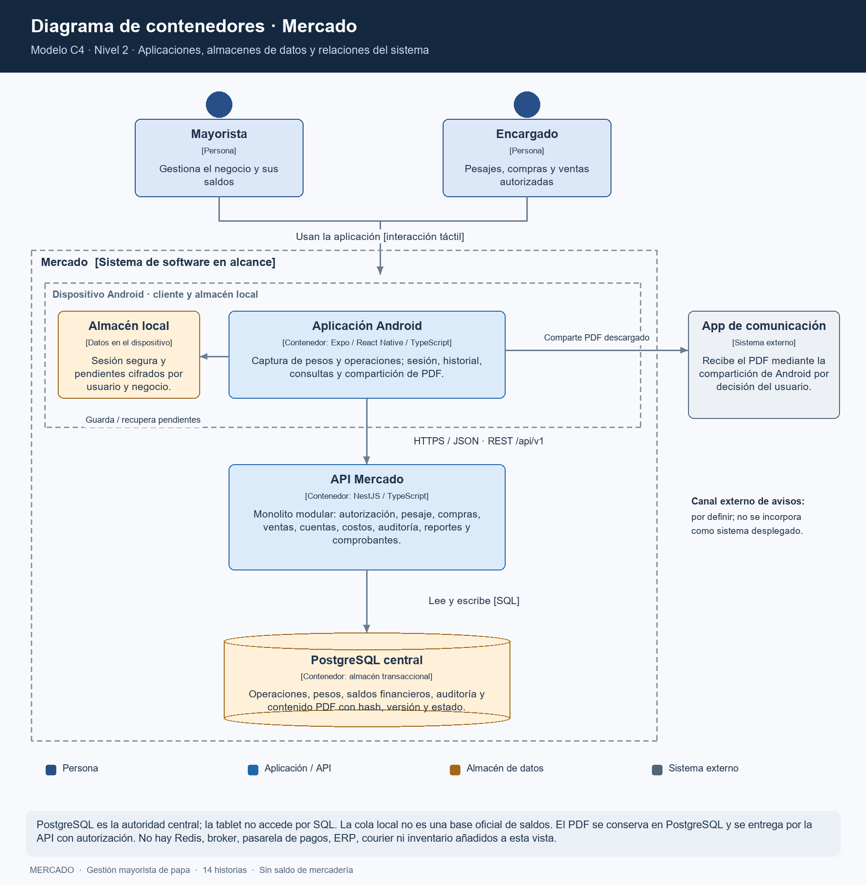

# Nivel 2 Diagrama de contenedores

> **Proyecto:** Gestión mayorista de papa · **Modelo:** C4 · **Nivel:** 2 · **Versión:** 1.3

## Objetivo

Abrir el sistema Mercado del nivel 1 y mostrar las aplicaciones y almacenes de datos que lo componen, sus responsabilidades y cómo se comunican. Un contenedor C4 es una aplicación o almacén de datos; no equivale necesariamente a un contenedor Docker. Los módulos internos de la API se detallan en el nivel 3.

## Diagrama de contenedores

Fuente editable: [nivel2-contenedores.svg](../../img/fuentes-svg/nivel2-contenedores.svg).

## Personas

Mayorista y Encargado utilizan la aplicación Android con credenciales individuales. El Encargado registra pesajes, compras y ventas únicamente durante un reemplazo autorizado y vigente. La interfaz ayuda a mostrar permisos, pero la API revalida cada operación y su negocio.

## Aplicaciones y almacenes de datos

| Contenedor o almacén | Tecnología registrada | Responsabilidad | Datos |
| --- | --- | --- | --- |
| Aplicación Android | Expo, React Native y TypeScript | Interacción táctil, sesión, captura, recuperación de pendientes, consultas y compartición | Estado visual y representación local de operaciones |
| Almacén local asociado al cliente | Almacenamiento seguro de sesión y cola cifrada | Conservar órdenes autorizadas durante pérdida de red, aisladas por usuario/negocio | Sesión, claves y pendientes; no es fuente oficial de saldos |
| API Mercado | NestJS y TypeScript | Ejecutar autorización y reglas comerciales en un monolito modular | Coordina datos y devuelve resultados centrales confirmados |
| PostgreSQL central | PostgreSQL y persistencia mediante TypeORM | Confirmar operaciones y efectos financieros con transacciones | Recepciones, sacos, compras, ventas, despachos, cuentas, costos, auditoría y comprobantes PDF |

El almacén local forma parte del dispositivo; no implica un servidor adicional. La API y sus módulos se despliegan juntos. PostgreSQL es el almacén central; el contenido PDF no introduce un servicio de objetos separado en la implementación constatada.

## Relaciones

| Origen | Destino | Relación | Mecanismo |
| --- | --- | --- | --- |
| Mayorista / Encargado | Aplicación Android | Usa las funciones de su rol | Interacción táctil |
| Aplicación Android | Almacén local | Conserva y recupera sesión/órdenes pendientes | Acceso local y cifrado |
| Aplicación Android | API Mercado | Envía órdenes y consulta resultados/datos/PDF | REST `/api/v1`, HTTPS/JSON en despliegue |
| API Mercado | PostgreSQL | Lee y escribe operaciones, finanzas, auditoría y PDF | SQL y transacciones |
| Aplicación Android | Aplicación externa elegida | Comparte el comprobante descargado por decisión del usuario | Panel de compartición del dispositivo |

Las flechas representan la relación principal; consultas y escrituras incluyen sus respuestas. No hay conexión SQL desde Android a PostgreSQL ni sincronización directa entre los dos almacenes.

## Persistencia de comprobantes verificada

`mercado-api/src/receipts/receipt-document.entity.ts` representa el archivo mediante un campo `content` de tipo `bytea`. `receipts.service.ts` conserva el contenido, nombre, tipo MIME, hash SHA-256 y estado/versionado del comprobante en PostgreSQL. La descarga pasa por un contrato autenticado; después Android puede compartir el archivo.

Las vistas de componentes o estilo que muestran almacenamiento de PDF expresan esta responsabilidad lógica de conservación. No deben interpretarse como evidencia de un contenedor de archivos independiente ni de un proveedor contratado.

## Seguridad y consistencia

- La aplicación utiliza token opaco de sesión; la API controla negocio, rol, recurso y reemplazo vigente.
- HTTPS protege tráfico en despliegue; la verificación local puede utilizar HTTP sin acreditar la configuración de producción.
- El servidor conserva las credenciales de PostgreSQL; el dispositivo no las recibe.
- La cola local se protege y aísla por usuario y negocio. Una operación pendiente no se presenta como confirmación central.
- La API reutiliza el UUID para recuperar un resultado previo y comprueba versión para gestionar conflictos sin sobrescritura silenciosa.
- Los PDF se autorizan igual que las operaciones que representan. Compartir un comprobante interno no es facturación electrónica.

## Alcance y decisiones

Compras, pesos, ventas y despachos conservan historial sin inventario, saldo de mercadería, descuento de stock o bloqueo por disponibilidad. Los saldos de dinero permanecen centrales.

HU01–HU14 se atienden con estas aplicaciones y responsabilidades; no requieren un contenedor por historia. HU05 justifica continuidad local y sincronización vía API; HU10 justifica descarga y compartición. La analítica se organiza dentro de las responsabilidades de la API y conserva las condiciones de datos y evaluación aprobadas; no se supone un servidor de IA separado.

No se incorporan Redis, broker, pasarela de pagos, ERP, courier o balanzas desde el ejemplo. El canal externo de avisos HU14 sigue por definir. Respaldos, monitoreo, balanceo y configuración de despliegue requieren una vista operativa y evidencia propias; no se inventa su contratación ni funcionamiento a partir de este diagrama.

Anterior: [Nivel 1 Contexto](Nivel1-DiagramadeContextodelSistema.md). Siguiente: [Nivel 3 Componentes](Nivel3-Diagrama-de-Componentes.md).
