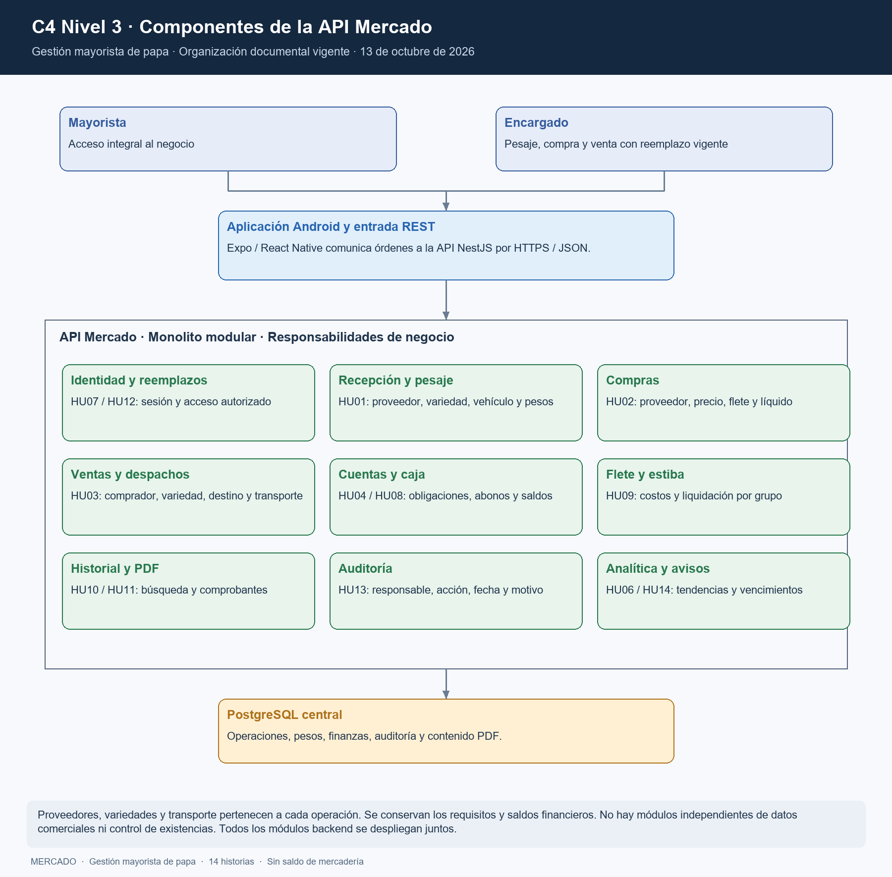

# Nivel 3 · Diagrama de componentes

> **Proyecto:** Gestión comercial mayorista de papa · **Modelo:** C4 · **Contenedor:** API Mercado · **Versión:** 2.0 · **Actualización:** 29 de octubre de 2026

## Objetivo

Abrir el contenedor API Mercado y mostrar sus componentes y relaciones. Todos se ejecutan dentro del mismo proceso NestJS.

## Diagrama

Fuente editable: [nivel3-componentes.svg](../../img/fuentes-svg/nivel3-componentes.svg).

## Componentes

| Componente | Código en `backend/src` | Función | Historias |
| --- | --- | --- | --- |
| API REST | Controladores, DTO, guardas, filtro de errores | Entrada `/api/v1`: sesión, rol, negocio y validación | — |
| 1 · Identidad y acceso | `identity` | Sesiones, Encargados y reemplazos | HU07, HU12 |
| 2 · Recepción y compras | `reception`, `purchase` | Sacos, tara, neto, cierre y liquidación al proveedor | HU01, HU02 |
| 3 · Ventas y despachos | `sales` | Venta, anulación y devoluciones comerciales | HU03 |
| 4 · Cuentas y caja | `accounts` | Cuotas, abonos, reversos, caja y vencimientos | HU04, HU08, HU14 |
| 5 · Costos logísticos | `freight`, `stowage` | Registro y liquidación de flete y estiba | HU09 |
| 6 · Documentos | `receipts` | Comprobantes PDF y estado de cuenta | HU10, HU16 |
| 7 · Mensajería | `messaging` | Destinatarios, avisos e intentos de envío | HU14, HU15, HU16 |
| 8 · Reportes y analítica | `reports`, `analytics` | Reportes, historial, tendencias y predicción | HU06, HU11 |
| Auditoría | `audit` | Registro y consulta de eventos | HU13 |
| Referencias comerciales | `catalog`, `logistics` | Proveedores, compradores, variedades, calidades, procedencias, transportistas y vehículos | HU01, HU03 |
| Sincronización | `operations` | Consultar el resultado de una operación por su UUID | HU05 |

## Relaciones principales

| Origen | Destino | Relación | Mecanismo |
| --- | --- | --- | --- |
| Android | API REST | Operaciones, consultas y descargas | HTTPS/JSON |
| API REST | Identidad | Verifica sesión, rol y reemplazo | Guardas en el proceso |
| Recepción y compras | Cuentas y caja, Costos logísticos | Cuenta por pagar o salida de caja; flete pendiente | Misma transacción |
| Ventas | Cuentas y caja, Costos logísticos | Cuenta por cobrar o ingreso de caja; flete pendiente; devoluciones | Misma transacción |
| Costos logísticos | Cuentas y caja | Salida de caja de la liquidación | Misma transacción |
| Documentos | Compras, Ventas, Cuentas | Lee importes confirmados | Lectura en el proceso |
| Mensajería | Referencias, Cuentas y caja | Destinatarios y vencimientos | Lectura en el proceso |
| Módulos operativos | Auditoría | Registran cada hecho | Misma transacción |
| Reportes y analítica | PostgreSQL | Consultas de hechos confirmados por negocio | SQL de lectura |

## Colores

Azul: entrada REST. Índigo: identidad. Verde: módulos operativos (2, 3). Ámbar: módulos financieros (4, 5). Violeta: información y documentos (6, 7, 8). Gris: transversales.

## Reglas

1. Los módulos se despliegan juntos; una colaboración interna no es una llamada de red.
2. La API controla sesión, rol, reemplazo, negocio y recurso en cada solicitud.
3. UUID, versión y transacción evitan duplicados y cambios parciales.
4. Auditoría y compensaciones conservan hechos, origen y motivo; los reportes no modifican operaciones.

Anterior: [Nivel 2](Nivel2-DiagramadeContenedores.md) · Siguiente: [Nivel 4](Nivel4-DiagramadeCodigo.md).
