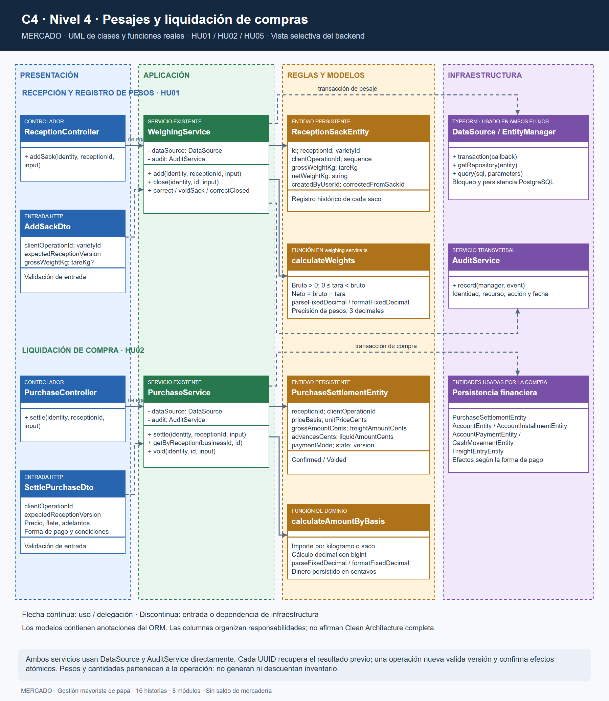
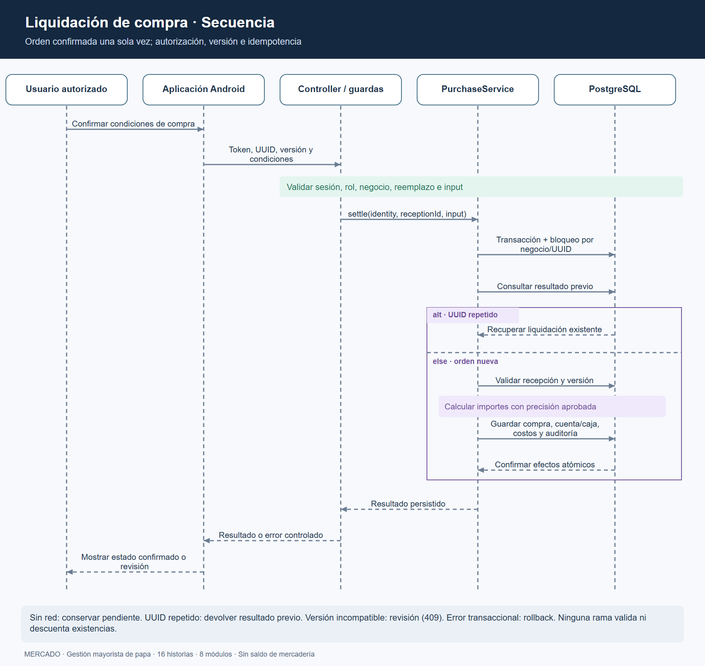

# C4 nivel 4: código de pesajes y liquidación de compras

> **Proyecto:** Gestión comercial mayorista de papa · **Módulo:** Recepción y compras · **Versión:** 2.0 · **Referencia técnica:** código revisado el 29 de octubre de 2026

## Objetivo y alcance

Mostrar las clases, contratos de entrada, funciones y dependencias que colaboran al ingresar el peso de un saco (HU01) y liquidar una compra (HU02). HU05 permite preparar órdenes sin conexión en Android; la confirmación central conserva autorización, versión e idempotencia.

## Diagrama de código

Fuente editable: [nivel4-clases.svg](../../img/fuentes-svg/nivel4-clases.svg).

El diagrama tiene cuatro columnas: presentación (azul), servicios (verde), reglas y modelos (ámbar) e infraestructura (violeta). Los nombres son los del código. Las entidades son modelos TypeORM, y `WeighingService` y `PurchaseService` reciben directamente `DataSource` y `AuditService`; los puertos y casos de uso extraídos son evolución y no aparecen aquí.

| Elemento | Responsabilidad | Referencia técnica |
| --- | --- | --- |
| ReceptionController / AddSackDto | Recibir y validar la orden de ingreso de peso | `src/reception/reception.controller.ts`, `src/reception/http/weighing.dto.ts` |
| WeighingService | Coordinar alta, cierre y correcciones del pesaje | `src/reception/weighing.service.ts` |
| ReceptionSackEntity | Conservar variedad, secuencia, pesos, UUID y responsable | `src/reception/entities/reception-sack.entity.ts` |
| calculateWeights | Validar bruto/tara y calcular peso neto a tres decimales | Función en `weighing.service.ts` |
| PurchaseController / SettlePurchaseDto | Recibir condiciones y versión de la recepción | `src/purchase/purchase.controller.ts`, `src/purchase/http/settle-purchase.dto.ts` |
| PurchaseService | Recuperar una liquidación previa o confirmar una nueva | `src/purchase/purchase.service.ts` |
| PurchaseSettlementEntity | Conservar precio, flete, adelantos, líquido y estado | `src/purchase/entities/purchase-settlement.entity.ts` |
| calculateAmountByBasis | Calcular importes por kilogramo o saco | `src/common/domain/commercial-calculation.ts` |
| parseFixedDecimal / formatFixedDecimal | Convertir cantidades decimales con precisión definida | `src/common/domain/fixed-decimal.ts` |
| requireSameOperation | Rechazar con `409` un UUID reutilizado con datos distintos | `src/common/domain/operation-replay.ts` |
| resolveCommercialSnapshot | Validar y copiar calidad y procedencia del saco | `src/catalog/commercial-snapshot.ts` |
| DataSource / EntityManager | Ejecutar transacciones y acceder a repositorios | Dependencias TypeORM de ambos servicios |
| AuditService | Registrar hechos en la transacción correspondiente | `src/audit/audit.service.ts` |

Las rutas son relativas a `backend/`. La vista es selectiva y omite campos y métodos secundarios. Recepción y saco se asocian mediante `receptionId`.

## Recorrido de ingreso de pesos

1. Mayorista o Encargado con reemplazo vigente envía variedad, calidad, procedencia, peso bruto, tara opcional, UUID y versión esperada.
2. El controlador aplica las guardas y validación de entrada y delega en `WeighingService.add`.
3. El servicio abre una transacción y busca un saco previo con ese UUID; si existe y los datos coinciden, lo devuelve sin crear otro; si difieren, responde `409`.
4. Para una orden nueva valida recepción, versión, estado y variedad. `calculateWeights` exige bruto positivo y tara no negativa menor al bruto.
5. Confirma saco, secuencia, versión de recepción y auditoría juntos. Los pesos tienen tres decimales; por ejemplo, 52.500 − 0.500 = 52.000 kg.

## Recorrido de liquidación de compra

La compra utiliza una recepción con pesaje cerrado. `PurchaseService.settle` busca primero una liquidación con el mismo UUID (devolviéndola si coincide, `409` si no); si no existe, valida recepción y versión, calcula importes con aritmética decimal exacta y confirma liquidación, cuenta o caja y flete en una transacción. Usa directamente entidades de Cuentas y caja y de Costos logísticos.

Fuente editable: [nivel4-secuencia.svg](../../img/fuentes-svg/nivel4-secuencia.svg).

| Situación | Resultado esperado |
| --- | --- |
| Sin conexión | Orden autorizada pendiente en el cliente; no equivale a confirmación central |
| Respuesta perdida y UUID repetido | Recuperar resultado previo sin duplicar efectos |
| UUID reutilizado con otros datos | `409 operation-id-conflict`, sin efectos |
| Versión desactualizada | Conflicto y revisión, sin sobrescribir |
| Permiso o reemplazo inválido | Rechazo central sin efectos comerciales |
| Error en la transacción | Rollback, sin confirmación parcial |
| Anulación posterior | Compensación autorizada con motivo y auditoría |

## Alcance y verificación

Las cantidades y pesos son registros históricos de cada operación. No hay saldo de mercadería, validación de disponibilidad, descuento de stock ni valoración de lotes. Se mantienen cuentas por pagar y cobrar, caja, pagos y deudas.

Pruebas que cubren esta vista: `purchase.service.spec.ts`, `purchase-without-inventory.spec.ts`, `reception.service.spec.ts` y `operation-replay.spec.ts` (precisión, reintentos, UUID reutilizado, versión, permisos y compensación). La suite unitaria del backend pasaba completa (253 pruebas) el 29 de octubre de 2026.

La extracción hacia casos de uso y puertos está descrita en [principios de diseño](../03-diseño-de-software/diseño-interno/principios-de-diseño.md).

Anterior: [nivel 3: componentes](Nivel3-Diagrama-de-Componentes.md). Detalle: [diseño interno](../03-diseño-de-software/diseño-interno/diseño-interno-de-modulos.md).
